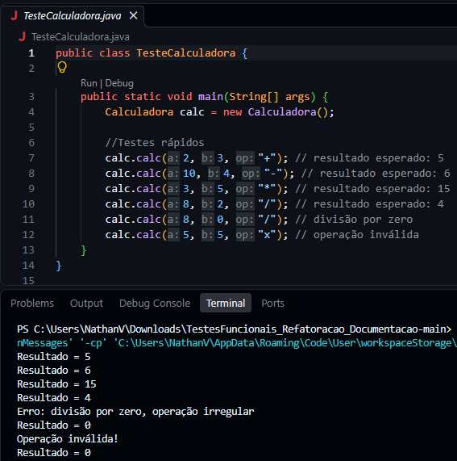
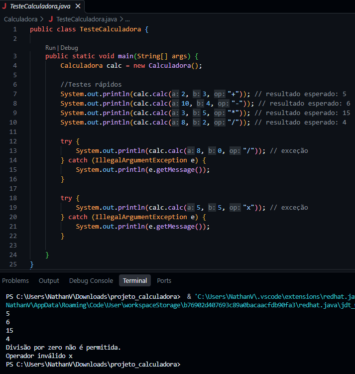
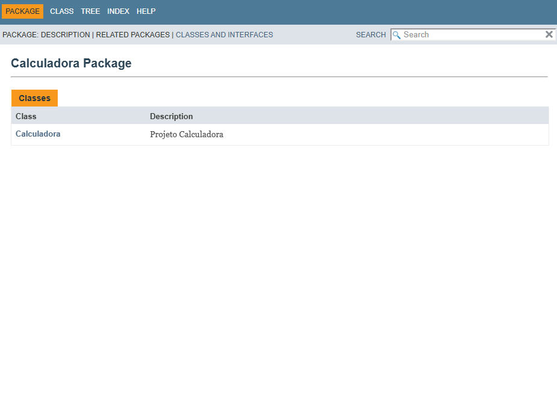

# FinançApp — Calculadora Java

## 1. Descrição do projeto

Este projeto consiste no desenvolvimento de uma calculadora em Java para a startup fictícia FinançApp, uma aplicação voltada ao controle de finanças pessoais.

A calculadora realiza operações matemáticas básicas e representa um módulo que pode ser utilizado em diversas áreas financeiras.

O desenvolvimento contempla a implementação das funcionalidades, a realização de testes, o tratamento de erros, a refatoração do código e a geração de documentação técnica.

## 2. Objetivo da atividade

O objetivo desta atividade é aplicar conceitos de qualidade de software durante o desenvolvimento de uma aplicação Java, trabalhando com:

- Implementação de funcionalidades;
- Testes funcionais e validação dos resultados;
- Tratamento de erros;
- Refatoração e melhoria da legibilidade do código;
- Documentação técnica utilizando JavaDoc;
- Versionamento do código com Git e GitHub.

## 3. Tecnologias utilizadas

- **Java:** linguagem utilizada no desenvolvimento da calculadora.
- **Visual Studio Code:** ambiente utilizado para edição do código e execução dos comandos.
- **Git:** ferramenta utilizada para o controle de versão.
- **GitHub:** plataforma utilizada para armazenar e versionar o projeto remotamente.
- **JavaDoc:** ferramenta utilizada para gerar a documentação técnica em HTML.

## 4. Funcionalidades e operações

A calculadora possui o método principal `calc(int a, int b, String op)`, responsável por receber dois números inteiros e um operador matemático.

As operações implementadas são:

| Operação | Operador | Exemplo | Resultado esperado |
|---|---|---|---|
| Soma | `+` | `5 + 3` | `8` |
| Subtração | `-` | `10 - 4` | `6` |
| Multiplicação | `*` | `6 * 3` | `18` |
| Divisão | `/` | `10 / 2` | `5` |

Também são tratados os seguintes casos:

- **Divisão por zero:** apresenta uma mensagem de erro e impede a realização da divisão.
- **Operação inválida:** apresenta uma mensagem informando que o operador não é reconhecido.

O programa foi desenvolvido para tratar essas situações sem interromper indevidamente sua execução.

## 5. Testes funcionais

A classe `TesteCalculadora.java` é utilizada para verificar o comportamento da calculadora.

Os cenários previstos na atividade são:

- Soma;
- Subtração;
- Multiplicação;
- Divisão;
- Divisão por zero;
- Operações inválidas.

Os testes apresentam as entradas utilizadas, os resultados esperados e os resultados obtidos, permitindo verificar o comportamento da aplicação.

### 5.1. Testes da implementação inicial



### 5.2. Testes após a refatoração



## 6. Refatoração do código

Após a implementação inicial, o código foi reorganizado na branch `Refatoracao`, com o objetivo de melhorar sua legibilidade, organização e manutenção.

O processo de refatoração contempla melhorias na estrutura do código e na organização das condições responsáveis pela seleção das operações.

Após as alterações, os cenários de teste devem ser executados novamente para verificar se o comportamento da calculadora permanece correto.

## 7. Documentação JavaDoc

A documentação técnica foi gerada utilizando JavaDoc, ferramenta que produz páginas HTML a partir dos comentários documentados no código-fonte.

A documentação contempla informações sobre as classes, os métodos, os atributos, os parâmetros e os valores de retorno documentados.

O arquivo principal da documentação é:

`docs/index.html`

### 7.1. Captura da documentação gerada



## 8. Estrutura do projeto

```text
projeto_calculadora/
├── Calculadora/
│   ├── Calculadora.java
│   └── TesteCalculadora.java
├── docs/
│   └── index.html
└── README.md
```

## 9. Versionamento

O projeto utiliza Git e GitHub para registrar o histórico de desenvolvimento.

As branches utilizadas na atividade são:

- `main`: versão principal do projeto.
- `Refatoracao`: versão destinada às melhorias de organização e legibilidade do código.

O histórico de commits permite acompanhar as alterações realizadas durante o desenvolvimento.

## 10. Repositório GitHub

Repositório do projeto:

https://github.com/Nathan0Vv/Calculadora

## 11. Autor

Desenvolvido individualmente por Nathan Vieira como atividade acadêmica da disciplina UX/UI e Testes de Software, da UniFacens.